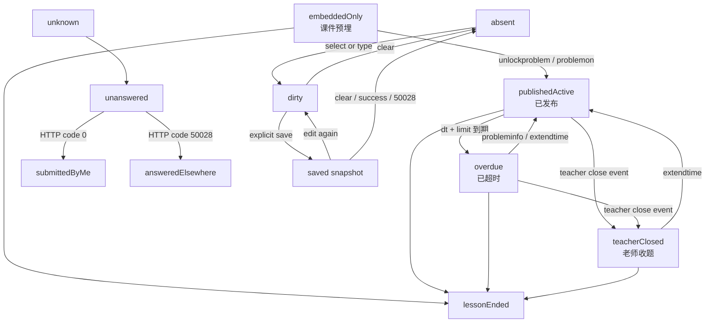
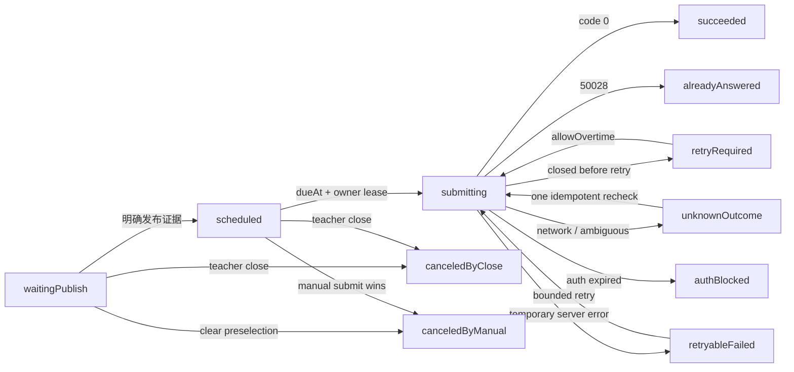
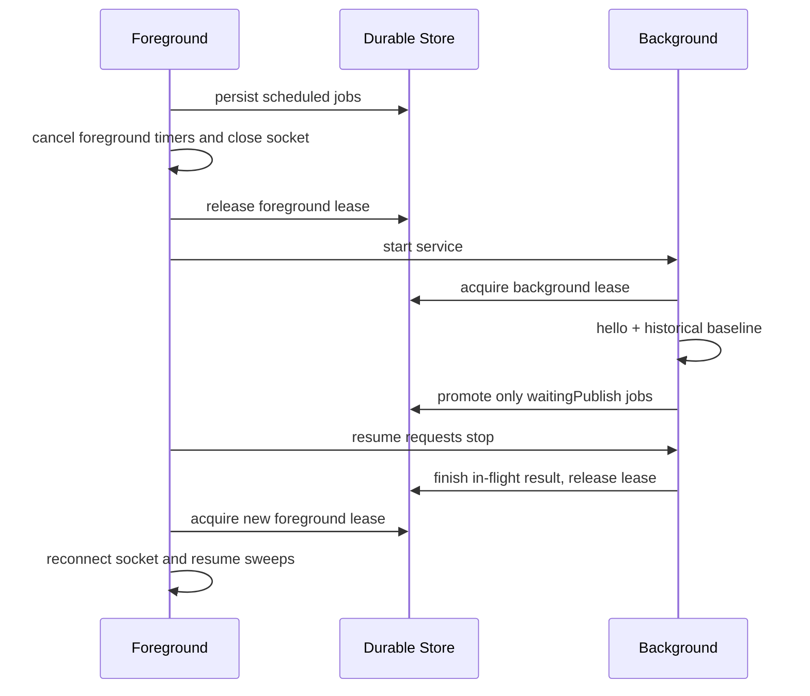

# 随堂习题状态机

## 题目、作答与草稿

`dirty` 只能用于恢复编辑内容，不能触发自动提交。自动提交永远读取 `saved snapshot`。

## 提交任务

## 前后台所有权

## 不变量

1. 历史时间线和初次 `hello` 不得仅凭草稿创建自动提交任务。
2. 自动提交只读取用户明确保存的不可变答案快照。
3. 同一课堂同一时刻只有一个运行所有者。
4. 手动提交和自动提交共用同一题的任务锁。
5. 收题在请求发出前取消任务；已发出的请求等待明确结果。
6. 网络结果未知时只做有限次幂等复核，`50028` 是最终去重信号。
7. 登录失效时保留草稿和任务，但立即停止所有提交与重连。
